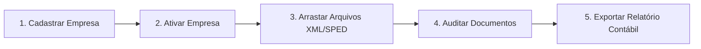

# 📖 Manual do Usuário — FiscalFlow

**Versão do Manual:** 27 de Setembro de 2026  
**Versão do Sistema Homologada:** 1.0.0  
**Fabricante:** Xtreme Sistemas  
**Plataforma Homologada:** Microsoft Windows 10 e 11 (64-bit) / Web Preview  

---

## Sumário

- [1. Visão Geral do Sistema](#1-visão-geral-do-sistema)
  - [1.1. O que é o FiscalFlow e para quem foi desenvolvido](#11-o-que-é-o-fiscalflow-e-para-quem-foi-desenvolvido)
  - [1.2. Principais Vantagens](#12-principais-vantagens)
  - [1.3. O Conceito Offline-First Explicado de Forma Simples](#13-o-conceito-offline-first-explicado-de-forma-simples)
- [2. Como Instalar e Acessar o Sistema](#2-como-instalar-e-acessar-o-sistema)
  - [2.1. Instalação no Windows (Desktop — .exe ou .msi)](#21-instalação-no-windows-desktop--exe-ou-msi)
  - [2.2. Acesso e Uso via Navegador / PWA](#22-acesso-e-uso-via-navegador--pwa)
- [3. Guia de Início Rápido (Primeiros Passos)](#3-guia-de-início-rápido-primeiros-passos)
- [4. O Funcionamento Offline e Seus Dados](#4-o-funcionamento-offline-e-seus-dados)
  - [4.1. Onde ficam salvos os seus dados](#41-onde-ficam-salvos-os-seus-dados)
  - [4.2. Operações 100% Funcionais sem Internet](#42-operações-100-funcionais-sem-internet)
  - [4.3. Segurança, Backups e Manutenção de Rotina](#43-segurança-backups-e-manutenção-de-rotina)
- [5. Manual Operacional Passo a Passo](#5-manual-operacional-passo-a-passo)
  - [5.1. Barra Superior (Header) e Barra de Status (Footer)](#51-barra-superior-header-e-barra-de-status-footer)
  - [5.2. Módulo de Empresas Cadastradas (`#/companies`)](#52-módulo-de-empresas-cadastradas-companies)
  - [5.3. Módulo de Importação de Documentos (`#/import`)](#53-módulo-de-importação-de-documentos-import)
  - [5.4. Módulo de Documentos Fiscais (`#/documents`)](#54-módulo-de-documentos-fiscais-documents)
  - [5.5. Modal de Detalhes e Auditoria do Documento Fiscal](#55-modal-de-detalhes-e-auditoria-do-documento-fiscal)
  - [5.6. Módulo do SPED Fiscal (EFD ICMS/IPI) (`#/sped`)](#56-módulo-do-sped-fiscal-efd-icmsipi-sped)
  - [5.7. Modal de Auditoria Profunda do SPED Fiscal](#57-modal-de-auditoria-profunda-do-sped-fiscal)
  - [5.8. Módulo de Dashboard Executivo (`#/dashboard`)](#58-módulo-de-dashboard-executivo-dashboard)
  - [5.9. Central de Exportação Fiscal & Contábil (`#/export`)](#59-central-de-exportação-fiscal--contábil-export)
  - [5.10. Módulo de Configurações do Sistema (`#/settings`)](#510-módulo-de-configurações-do-sistema-settings)
- [6. Perguntas Frequentes (FAQ)](#6-perguntas-frequentes-faq)
- [7. Solução de Problemas (Troubleshooting)](#7-solução-de-problemas-troubleshooting)
- [8. Boas Práticas e Recomendações Finais](#8-boas-práticas-e-recomendações-finais)

---

## 1. Visão Geral do Sistema

### 1.1. O que é o FiscalFlow e para quem foi desenvolvido

O **FiscalFlow** é uma solução de auditoria, organização, gestão e prévia contábil de documentos fiscais eletrônicos brasileiros desenvolvida pela **Xtreme Sistemas**. 

O sistema foi desenhado especificamente para:
- **Escritórios de Contabilidade e BPOs Fiscais:** que recebem milhares de arquivos XML e TXT todos os meses e necessitam de conferência ágil, separação por empresa e fechamento de impostos sem falhas.
- **Empresas Comerciais e Industriais:** que precisam controlar suas notas de entrada e saída, monitorar volumes tributários e cruzar informações com fornecedores e clientes.
- **Auditores e Analistas Fiscais:** que realizam conciliação de Escrituração Fiscal Digital (SPED EFD ICMS/IPI) e verificação de autenticidade documental.

### 1.2. Principais Vantagens

1. **Agilidade Extrema:** Construído sobre arquitetura de alto desempenho (Tauri 2 + SQLite local), carrega instantaneamente milhares de registros sem lentidão.
2. **Suporte Multiformato Oficial:** Processa nativamente **NF-e** (Nota Fiscal Eletrônica Modelo 55 v4.00), **NFC-e** (Nota Fiscal ao Consumidor Modelo 65), **CT-e** (Conhecimento de Transporte Modelo 57), **NFS-e** (Nota Fiscal de Serviços Eletrônica, com suporte duplo ao Padrão Nacional e ao padrão ABRASF 2.04) e **SPED Fiscal** (EFD ICMS/IPI, Registros 0000, 0100, C100 e E110).
3. **Desduplicação Inteligente com Hash Criptográfico:** Cada arquivo importado tem seu hash SHA-256 e chave de acesso validados. Documentos repetidos são detectados e ignorados automaticamente, prevenindo lançamentos em duplicidade.
4. **Exportação Formatada para o Brasil:** Exporta planilhas em CSV compatíveis com o Excel em português (separador ponto e vírgula, vírgula para decimais e padrão UTF-8 BOM) e pacotes ZIP organizados com manifesto contábil pronto para envio ao contador.
5. **Privacidade Absoluta:** O FiscalFlow não envia seus dados financeiros nem notas para nenhum servidor na nuvem. Tudo permanece 100% no seu próprio computador.

### 1.3. O Conceito Offline-First Explicado de Forma Simples

Diferente de sistemas web tradicionais que travam ou deixam de funcionar se a conexão com a internet cair, o **FiscalFlow foi concebido sob a filosofia Offline-First**.

Isso significa que:
- **A internet NÃO é obrigatória para usar o sistema:** O banco de dados do FiscalFlow fica gravado dentro da sua própria máquina.
- **Você pode importar, consultar, emitir relatórios e calcular impostos mesmo desconectado:** Se você estiver em uma viagem, em um cliente sem sinal de Wi-Fi ou se a internet da sua empresa cair, seu trabalho continua normalmente.
- **Velocidade incomparável:** As leituras e gravações ocorrem diretamente no seu disco rígido local (SSD/HD), sem o atraso típico de requisições de rede.

---

## 2. Como Instalar e Acessar o Sistema

O FiscalFlow foi planejado para atender tanto ambientes corporativos de alta performance (Desktop Windows nativo) quanto cenários de visualização e conferência em navegadores modernos.

### 2.1. Instalação no Windows (Desktop — .exe ou .msi)

A versão Desktop Windows é a distribuição oficial e principal do sistema, empacotada com o **Tauri 2**.

#### Requisitos Mínimos do Sistema:
- **Sistema Operacional:** Microsoft Windows 10 (versão 1809 ou superior) ou Windows 11 (64-bit).
- **Processador:** Dual-core 1.6 GHz ou superior.
- **Memória RAM:** Mínimo de 2 GB (recomendado 4 GB ou mais para bases com mais de 50.000 notas).
- **Espaço em Disco:** 150 MB livres para a aplicação e banco de dados.
- **Componente de Sistema:** *Microsoft Edge WebView2 Runtime* (já vem pré-instalado de fábrica no Windows 10 e Windows 11 atualizados).

#### Passo a Passo de Instalação:

1. **Obtenha o Instalador:**
   - Para computadores individuais: execute o instalador executável `FiscalFlow_1.0.0_x64-setup.exe`.
   - Para ambientes corporativos com Active Directory ou instalação automatizada: utilize o pacote corporativo `FiscalFlow_1.0.0_x64.msi`.
2. **Execute o Arquivo:** Dê dois cliques no instalador baixado.
3. **Aviso do Windows SmartScreen (Importante):**
   Como o FiscalFlow é um aplicativo corporativo interno ou compilado diretamente, o sistema operacional Windows pode exibir uma janela azul com o título:  
   `O Windows protegeu o seu computador — O Microsoft Defender SmartScreen impediu a inicialização de um aplicativo não reconhecido.`
   
   > [!IMPORTANT]  
   > **Como prosseguir com segurança:**  
   > 1. Na janela azul do SmartScreen, clique no link sublinhado **"Mais informações"**.  
   > 2. Em seguida, surgirá um botão no canto inferior direito chamado **"Executar assim mesmo"**. Clique nele.  
   > 3. A instalação iniciará imediatamente. O aplicativo é seguro, não contém anúncios e opera localmente.

4. **Conclusão:** O instalador criará os atalhos automaticamente:
   - **Área de Trabalho:** Ícone `FiscalFlow`.
   - **Menu Iniciar:** Localize em `FiscalFlow — Xtreme Sistemas`.
5. Ao abrir o aplicativo, uma janela independente de 1280x800 pixels será carregada com a interface do sistema.

### 2.2. Acesso e Uso via Navegador / PWA

O FiscalFlow também pode ser acessado via navegadores modernos (Google Chrome, Microsoft Edge, Brave) quando disponibilizado em um servidor interno ou ambiente local (`http://localhost:1420` em desenvolvimento ou pelo endereço IP/URL da sua rede interna).

#### Navegadores Recomendados:
- **Microsoft Edge** (versão 115 ou superior)
- **Google Chrome** (versão 115 ou superior)

#### Como Instalar como Aplicativo pelo Navegador:
1. Abra o endereço do FiscalFlow no **Google Chrome** ou **Microsoft Edge**.
2. Na barra de endereços do navegador (à direita, próxima ao botão de favoritos), observe o ícone **"Instalar FiscalFlow"** (uma pequena tela de computador com uma seta para baixo ou o símbolo `+`).
3. Alternativamente, clique no **Menu de 3 pontos (`...`)** do navegador ➔ selecione **"Aplicativos"** (ou *Apps*) ➔ clique em **"Instalar este site como um aplicativo..."** ou **"Instalar FiscalFlow"**.
4. Confirme clicando em **"Instalar"**.
5. O navegador criará um atalho dedicado na sua Área de Trabalho e no Menu Iniciar. Ao abri-lo, o sistema rodará em sua própria janela isolada, sem barras de endereços ou abas.

> [!NOTE]  
> **Diferença Técnica entre Desktop (.exe/.msi) e Navegador:**  
> A versão Desktop instalada (.exe/.msi) conecta-se diretamente ao motor de banco de dados SQLite local de alto rendimento (`@tauri-apps/plugin-sql`). No navegador puro sem o componente Tauri ativo, o sistema opera em modo de demonstração/preview. Para produção contábil pesada, utilize sempre a versão Desktop instalada.

---

## 3. Guia de Início Rápido (Primeiros Passos)

Em menos de 3 minutos você estará operando o sistema. Siga esta sequência prática:

1. **Passo 1 — Cadastre a Empresa Titular:**  
   No menu lateral esquerdo, clique em **"Empresas"** e depois no botão azul **"Nova Empresa"**. Preencha o CNPJ, a Razão Social e o Regime Tributário. Clique em **"Cadastrar Empresa"**.
2. **Passo 2 — Defina como Empresa Ativa:**  
   Na tabela de empresas, clique no botão cinza **"Ativar"** ao lado da empresa recém-criada. O nome dela passará a ser exibido no topo da tela e na barra inferior.
3. **Passo 3 — Importe seus primeiros arquivos:**  
   Clique no menu **"Importar"**. Pegue uma pasta ou selecione arquivos `.xml` (NF-e, NFC-e, NFS-e, CT-e) ou `.txt` (SPED Fiscal) do seu computador e arraste para o retângulo pontilhado. O sistema processará tudo automaticamente e exibirá a barra de progresso.
4. **Passo 4 — Consulte os Documentos:**  
   Vá em **"Documentos"** no menu lateral. Todas as notas estarão listadas com seus emissores, destinatários, impostos e situação. Clique no ícone de "olho" para ver os detalhes completos de qualquer nota.
5. **Passo 5 — Visualize o Dashboard e Exporte:**  
   Acesse **"Dashboard"** para ver os gráficos de Entradas vs Saídas e impostos apurados. Se precisar mandar para a contabilidade, vá em **"Exportar"** e gere uma planilha em CSV ou um pacote ZIP contábil com um único clique.

---

## 4. O Funcionamento Offline e Seus Dados

### 4.1. Onde ficam salvos os seus dados

No FiscalFlow, seus dados pertencem exclusivamente a você:
- O banco de dados relacional é um arquivo local denominado `fiscalflow.db`, armazenado com segurança no diretório de dados da aplicação no Windows (gerenciado pelo plugin SQLite do Tauri).
- Os arquivos XML originais importados são preservados na íntegra no banco de dados, protegidos por uma chave hash SHA-256 única.
- Nenhuma informação transita por servidores remotos ou serviços de terceiros.

### 4.2. Operações 100% Funcionais sem Internet

Você pode realizar todas as rotinas fiscais abaixo com o computador completamente desconectado:
- Cadastro, edição e pesquisa de empresas clientes.
- Importação e validação de lotes com milhares de arquivos XML e SPED.
- Validação do dígito verificador da Chave de Acesso de 44 dígitos (Módulo 11 da SEFAZ).
- Conferência de alíquotas e bases de cálculo de ICMS, IPI, PIS, COFINS e ISS.
- Apuração do SPED Fiscal (EFD ICMS/IPI) dos blocos C (documentos) e E (saldo credor/devedor de ICMS).
- Gráficos executivos de faturamento e ranking de fornecedores/clientes.
- Geração de pacotes ZIP com arquivos originais e manifestos contábeis.
- Exportação de relatórios em formato CSV brasileiro para Excel ou LibreOffice Calc.

### 4.3. Segurança, Backups e Manutenção de Rotina

Como o sistema é local, você tem total autonomia sobre as suas cópias de segurança.

#### Como Fazer Backup dos Dados:
1. No menu lateral, acesse **"Configurações"**.
2. Role até a seção **"Cópia de Segurança (Backup & Restauração)"**.
3. Clique no botão **"Gerar e Baixar Cópia (.json)"**.
4. Uma caixa de diálogo do Windows abrirá para você escolher onde salvar o arquivo (por exemplo, `fiscalflow_backup_2026-09-27.json`). Você pode guardá-lo em um pendrive, disco externo ou pasta sincronizada corporativa.

#### Como Restaurar um Backup em Outro Computador:
1. Instale o FiscalFlow no novo computador.
2. Abra o FiscalFlow e vá em **"Configurações"**.
3. Clique em **"Restaurar Cópia de Segurança"** e selecione o arquivo `.json` gerado anteriormente.
4. O sistema solicitará confirmação em uma janela modal. Ao confirmar, todas as empresas, documentos e arquivos SPED serão restaurados com exatidão.

#### Alerta para Usuários da Versão Navegador:
> [!CAUTION]  
> Caso utilize o FiscalFlow pelo navegador da internet, **NUNCA execute a opção "Limpar dados de navegação / Cookies e dados de sites"** do navegador sem antes ter gerado e salvo o backup `.json`. A limpeza do navegador poderá apagar os dados locais de páginas web. Na versão Desktop instalada (.exe/.msi), esse risco não existe.

---

## 5. Manual Operacional Passo a Passo

### 5.1. Barra Superior (Header) e Barra de Status (Footer)

Em todas as telas do sistema, duas barras de apoio permanecem visíveis:

#### Barra Superior (Header):
- **Título da Tela:** Indica em qual seção você está no momento (ex.: *Dashboard*, *Documentos Fiscais*).
- **Indicador de Empresa Ativa (`#header-active-company`):**
  - Exibe `+ Selecionar Empresa` quando nenhuma empresa foi ativada.
  - Exibe `🏢 [Nome da Empresa]` quando uma empresa estiver selecionada. Ao clicar no badge, você é levado imediatamente para a tela de empresas para alternar.
- **Botão Alternar Tema (`#btn-theme-toggle`):** Alterna entre o Modo Escuro (*Dark*) e o Modo Claro (*Light*). Atalho de teclado rápido: `Alt + T`.

#### Barra Inferior (Status Bar):
- **Ponto Indicador de Status (`#status-dot`):** Luz verde que confirma que o motor local está ativo e operante.
- **Empresa em Operação (`#status-company`):** Exibe a Razão Social da empresa ativa.
- **Contador Total de Documentos (`#status-docs`):** Indica o número de documentos fiscais vinculados à empresa selecionada.
- **Versão:** Indica `v1.0.0`.

---

### 5.2. Módulo de Empresas Cadastradas (`#/companies`)

**Para que serve:** Centralizar as pessoas jurídicas cujos documentos serão gerenciados. Todo documento importado no sistema deve pertencer a uma empresa cadastrada.

[Local para print de tela: Listagem de Empresas Cadastradas com busca e botões de ação]

#### Elementos da Tela:

| Elemento / Campo | O que faz | Regras e Validações |
|---|---|---|
| **Botão "Nova Empresa"** (`#btn-new-company`) | Abre o modal para cadastro de uma nova empresa. | Disponível no cabeçalho superior direito. |
| **Campo de Busca** (`#filter-company-search`) | Filtra dinamicamente a tabela enquanto você digita. | Busca por CNPJ (formatado ou puro), Razão Social ou Nome Fantasia. |
| **Checkbox "Apenas ativas"** (`#check-only-active`) | Oculta empresas desativadas na listagem. | Opcional (filtro booleano). |
| **Coluna Ações — Botão "Ativar"** | Define a empresa daquela linha como o contexto ativo atual do sistema. | Sincroniza imediatamente o Header, Status Bar, Dashboard e Documentos. |
| **Coluna Ações — Botão "Editar"** | Abre o formulário da empresa preenchido para alterações. | Permite corrigir endereço, inscrições e regime tributário. |
| **Coluna Ações — Botão "Excluir"** | Remove a empresa do sistema com confirmação. | Se houver documentos vinculados, o sistema exibe alerta e exclui em cascata com autorização explícita. |

#### Formulário do Modal "Nova Empresa / Editar Empresa":

| Campo | Tipo | Obrigatoriedade | Regra de Validação |
|---|---|---|---|
| **CNPJ** | Texto | **Obrigatório** | Máscara automática `00.000.000/0000-00`. Valida estritamente os dois dígitos verificadores segundo a regra oficial da Receita Federal. Impede CNPJs duplicados. |
| **Razão Social** | Texto | **Obrigatório** | Nome oficial registrado na Junta Comercial ou Receita Federal. |
| **Nome Fantasia** | Texto | Opcional | Nome comercial da empresa. |
| **Inscrição Estadual (IE)** | Texto | Opcional | Número de cadastro junto à Secretaria de Fazenda Estadual. |
| **Inscrição Municipal (IM)** | Texto | Opcional | Número de cadastro junto à Prefeitura Municipal. |
| **Regime Tributário** | Seleção | Opcional | Opções: *Simples Nacional*, *Lucro Presumido*, *Lucro Real*, *MEI (Microempreendedor Individual)*. |
| **CEP** | Texto | Opcional | Formatação automática `00000-000`. |
| **Logradouro / Número** | Texto | Opcional | Rua, avenida, praça e número predial. |
| **Complemento / Bairro** | Texto | Opcional | Sala, andar, bloco e bairro. |
| **Município / UF** | Texto | Opcional | Cidade e estado (sigla com 2 caracteres em maiúsculo). |
| **Código Município** | Texto | Opcional | Código numérico de 7 dígitos do IBGE (ex: `3550308`). |
| **Empresa Ativa** | Checkbox | Opcional | Marcação de status operacional da empresa. |

#### Fluxo Prático:
1. Clique em **"Nova Empresa"**.
2. Digite o CNPJ com 14 números. A máscara será aplicada sozinha. Se os dígitos estiverem errados, o sistema avisará.
3. Preencha a Razão Social e selecione o Regime Tributário.
4. Clique em **"Cadastrar Empresa"**.
5. Na tabela, clique no botão **"Ativar"** na linha da empresa cadastrada para começar a trabalhar com ela.

---

### 5.3. Módulo de Importação de Documentos (`#/import`)

**Para que serve:** Receber lotes de arquivos XML e SPED Fiscal, analisar sua integridade estrutural, detectar o formato e armazená-los sem modificações no banco de dados.

[Local para print de tela: Área de soltar arquivos Drag and Drop com barra de progresso]

#### Elementos da Tela:

| Elemento / Campo | O que faz | Regras e Validações |
|---|---|---|
| **Aviso de Empresa Ativa** | Exibe para qual empresa os arquivos serão importados. | Se nenhuma empresa estiver ativa, exibe alerta amarelo e impede importações acidentais. |
| **Área Pontilhada (Dropzone)** (`#import-dropzone`) | Área sensível ao arrastar e soltar do mouse (*Drag and Drop*). | Aceita arquivos com extensão `.xml`, `.txt` ou pastas com múltiplos arquivos. |
| **Botão "Selecionar Arquivos no Computador"** (`#btn-select-files`) | Abre a janela nativa do Windows para navegação de pastas. | Permite seleção múltipla de arquivos (`Ctrl` ou `Shift` pressionados). |
| **Barra de Progresso** (`#import-progress-card`) | Exibe o avanço do lote em tempo real. | Mostra porcentagem, fração de arquivos processados (ex.: `84 / 120`) e nome do arquivo atual. |
| **Cards de Resumo do Relatório** | Badges com métricas finais pós-importação. | Divididos em: **Total**, **Importados**, **Duplicados** e **Erros**. |
| **Tabela Analítica de Importação** | Lista arquivo por arquivo com o resultado obtido. | Colunas: Arquivo, Tipo Detectado, Chave/Número, Status e Detalhes. |
| **Botão "Importar Mais Arquivos"** | Limpa o relatório e reabre a tela para novo lote. | Redefine o estado da dropzone. |
| **Botão "Ver Documentos"** | Redireciona o usuário diretamente para a listagem fiscal. | Atalho de navegação para conferência imediata. |

#### Regras de Processamento e Desduplicação:
- **Detecção Automática:** O sistema inspeciona as tags raiz do arquivo. Você não precisa separar NF-e de NFS-e ou CT-e; jogue tudo junto e o FiscalFlow identificará o tipo.
- **Desduplicação por Hash SHA-256 e Chave:** Se você selecionar sem querer um arquivo XML que já foi importado anteriormente, o sistema não duplicará a nota. Ele registrará o arquivo como **"Duplicado"**, mantendo a integridade da sua contabilidade intacta.

---

### 5.4. Módulo de Documentos Fiscais (`#/documents`)

**Para que serve:** Consultar, filtrar, auditar, copiar chaves e baixar o XML original de todas as notas fiscais importadas para a empresa ativa.

[Local para print de tela: Listagem de Documentos Fiscais com filtros de data e situação]

#### Elementos da Tela:

| Elemento / Campo | O que faz | Regras e Comportamento |
|---|---|---|
| **Campo de Busca Rápida** (`#filter-search`) | Pesquisa em múltiplos campos simultaneamente. | Filtra por número da nota, chave de 44 dígitos, CNPJ/CPF ou Razão Social do emitente e destinatário. |
| **Filtro "Tipo de Documento"** (`#filter-type`) | Seleciona o modelo fiscal a ser exibido. | Opções: *Todos os tipos*, *NF-e (55)*, *NFC-e (65)*, *NFS-e (Serviço)*, *CT-e (57)*. |
| **Filtro "Situação"** (`#filter-situacao`) | Filtra pelo status fiscal da nota. | Opções: *Todas as situações*, *Autorizada*, *Cancelada*, *Inutilizada*, *Denegada*. |
| **Data Início / Data Fim** (`#filter-date-from`, `#filter-date-to`) | Delimita o período de emissão dos documentos. | Seletores de data com calendário do Windows. |
| **Botão "Limpar"** (`#btn-clear-filters`) | Restaura todos os filtros para o padrão. | Recarrega a listagem completa da empresa ativa. |
| **Botão "CSV Rápido"** (`#btn-quick-csv`) | Exporta imediatamente a listagem filtrada para CSV. | Gera arquivo pronto para o Excel com os registros da tela. |
| **Tabela de Documentos** | Apresenta os registros fiscais com paginação. | Colunas: Tipo, Número/Série, Emissão, Emitente/Destinatário, Situação, Valor Total e Ações. |
| **Ação "Visualizar" (Ícone de Olho)** | Abre o modal de auditoria profunda com 4 abas. | Permite ver dados gerais, itens/produtos, impostos e XML. |
| **Ação "Copiar Chave" (Ícone de Prancheta)** | Copia os 44 dígitos da chave de acesso para a área de transferência. | Exibe aviso de confirmação na tela (*toast*). |
| **Ação "Baixar XML" (Ícone de Download)** | Faz o download do arquivo XML original. | Salva o arquivo no computador com nome padronizado. |
| **Controles de Paginação** | Botões "Anterior" e "Próxima" com indicador de páginas. | Respeita o tamanho de página configurado (10, 20, 50 ou 100 itens). |

---

### 5.5. Modal de Detalhes e Auditoria do Documento Fiscal

Ao clicar no ícone de "olho" em qualquer nota, uma janela modal se abrirá, dividida em quatro abas especializadas:

[Local para print de tela: Modal de Detalhes do Documento Fiscal com as 4 abas]

#### Aba 1: Identificação
- **Cabeçalho:** Número do documento, série, modelo e data/hora de emissão.
- **Chave de Acesso:** Exibe os 44 dígitos formatados em blocos de 4 caracteres. Possui um badge que indica se o **Dígito Verificador (DV) Módulo 11 da SEFAZ** é válido ou inconsistente.
- **Dados do Emitente:** Razão Social, CNPJ/CPF, Inscrição Estadual e UF.
- **Dados do Destinatário:** Razão Social, CNPJ/CPF, Inscrição Estadual e UF.
- **Totais Fiscais:** Valor total da nota e resumo de tributos destacados (ICMS, IPI, PIS, COFINS, ISS).

#### Aba 2: Itens / Produtos
- Tabela analítica com todos os produtos ou serviços contidos na nota.
- Colunas: Nº Item, Código do Produto, Descrição, NCM, CFOP, Unidade Comercial, Quantidade, Valor Unitário, Valor Total e Alíquota de ICMS.

#### Aba 3: Impostos / Tributos
- Detalhamento tributário com cards por esfera de tributação:
  - **ICMS:** Base de cálculo, alíquota e valor do imposto creditado ou debitado.
  - **IPI:** Base de cálculo, alíquota e valor apurado.
  - **PIS e COFINS:** Valores destacados para fins de crédito de PIS/Pasep e Cofins.
  - **ISS (no caso de NFS-e):** Valores de serviço, alíquota municipal e indicativo de retenção na fonte.

#### Aba 4: XML Original
- Apresenta o conteúdo integral do arquivo XML exatamente como foi emitido, formatado com indentação e fonte monoespaçada legível.
- **Botão "Copiar XML":** Envia todo o texto para a área de transferência do Windows.
- **Botão "Baixar Arquivo XML":** Grava uma cópia idêntica do XML no seu computador.

---

### 5.6. Módulo do SPED Fiscal (EFD ICMS/IPI) (`#/sped`)

**Para que serve:** Gestão e auditoria dos arquivos digitais de Escrituração Fiscal Digital enviados periodicamente à Receita Estadual e Federal.

[Local para print de tela: Tela do SPED Fiscal com lista de escriturações por período]

#### Elementos da Tela:

| Elemento / Campo | O que faz | Regras e Detalhes |
|---|---|---|
| **Botão "Importar Arquivo SPED"** (`#btn-import-sped`) | Redireciona para a central de importação. | Aceita arquivos de texto delimitados por barras verticais (`|`). |
| **Campo de Busca de SPED** (`#sped-filter-search`) | Pesquisa por período (ex: `202401`), leiaute ou finalidade. | Busca reativa instantânea. |
| **Tabela de Escriturações** | Exibe os arquivos SPED importados para a empresa ativa. | Colunas: Período Escriturado, Leiaute/Finalidade, Contador/CRC, Resumo de Blocos, Hash SHA-256 e Ações. |
| **Ação "Auditoria e Detalhes"** | Abre o modal de conferência profunda em 4 abas. | Inspeciona Blocos 0, C, E e o arquivo de texto. |
| **Ação "Baixar TXT"** | Faz o download do arquivo SPED original preservado. | Garante integridade do texto submetido. |
| **Ação "Copiar Hash"** | Copia o código criptográfico SHA-256 da escrituração. | Utilizado para comprovação de integridade e perícia contábil. |
| **Ação "Excluir SPED"** | Remove a escrituração do sistema com diálogo de confirmação. | Operação segura. |

---

### 5.7. Modal de Auditoria Profunda do SPED Fiscal

Ao auditar uma escrituração SPED, o modal organiza as informações em:
1. **Visão Geral e Contabilista (Registro 0000 e 0100):** Razão Social, CNPJ, período de apuração (data inicial e final), versão do leiaute (ex.: `018` ou `019`), finalidade do arquivo (original ou retificadora), além de Nome, CPF, número do CRC, telefone e e-mail do contador responsável.
2. **Bloco C — Documentos Mercantis (Registro C100):** Consolida o total de notas fiscais escrituradas no SPED, o valor mercantil total e o montante de ICMS destacado. Permite confrontar se todas as notas do período foram devidamente importadas.
3. **Bloco E — Apuração do ICMS (Registro E110):** Apresenta o cálculo oficial do imposto:
   - Total de Débitos por saídas.
   - Total de Créditos por entradas.
   - Ajustes de apuração.
   - **Resultado Final:** Saldo Devedor apurado a recolher ou Saldo Credor a ser transportado para o mês seguinte.
4. **Arquivo TXT e Integridade:** Visualização paginada das linhas originais em texto monoespaçado delimitado por pipe (`|`), com conferência de hash SHA-256 e download do arquivo.

---

### 5.8. Módulo de Dashboard Executivo (`#/dashboard`)

**Para que serve:** Apresentar uma visão panorâmica, gerencial e gráfica da saúde fiscal e do faturamento da empresa ativa em tempo real.

[Local para print de tela: Dashboard com cards de faturamento, gráfico de barras e rankings]

#### Indicadores e Seções Apresentadas:
- **Card Faturamento / Saídas:** Total financeiro de vendas e emissões da empresa ativa.
- **Card Compras / Entradas:** Total financeiro de insumos e compras recebidas de fornecedores.
- **Card Resultado Líquido Operacional:** Diferença entre saídas e entradas, com indicação visual de **Superávit Operacional** (verde) ou **Déficit Operacional** (amarelo/vermelho).
- **Card Carga Tributária Consolidada:** Soma total de todos os tributos calculados nos documentos (ICMS + IPI + PIS + COFINS + ISS).
- **Gráfico Mensal de Entradas vs Saídas:** Gráfico de barras responsivo comparando o faturamento mês a mês ao longo do tempo.
- **Distribuição por Modelo de Documento:** Barra segmentada que mostra o percentual de notas NF-e, NFC-e, NFS-e e CT-e.
- **Cards Tributários por Esfera:** Painéis dedicados para conferência rápida de ICMS, ISS municipal, PIS/COFINS federais e IPI.
- **Rankings Comerciais (Top 5):**
  - **Top 5 Fornecedores:** Principais parceiros de compras em volume financeiro.
  - **Top 5 Clientes:** Principais destinatários das suas notas e serviços.
- **Últimos Documentos Fiscais:** Lista rápida das notas mais recentes, com botão de visualização direta sem sair do Dashboard.

---

### 5.9. Central de Exportação Fiscal & Contábil (`#/export`)

**Para que serve:** Gerar pacotes de entrega para contabilidade, relatórios gerenciais e dados analíticos em formatos amplamente compatíveis.

[Local para print de tela: Os 4 cards de exportação com botões e filtros]

O FiscalFlow disponibiliza 4 módulos de exportação independentes:

#### Módulo 1: Pacote XML Contábil (ZIP)
Compacta em um único arquivo `.zip` todos os arquivos XML originais emitidos e recebidos no período.
- **Filtros Disponíveis:** Modelo de documento (Todos, NF-e, NFC-e, NFS-e, CT-e), situação (Apenas Autorizadas ou Todas), Data Início e Data Fim.
- **Manifesto de Auditoria Incluído:** Dentro do ZIP, o sistema cria automaticamente o arquivo `manifesto_exportacao.txt`, contendo o carimbo de data/hora da geração, total de notas e uma tabela com número, modelo, data, valor e hash SHA-256 de cada arquivo. O seu contador saberá exatamente o que foi enviado.
- **Barra de Progresso:** Acompanhamento da compactação arquivo a arquivo em tempo real.

#### Módulo 2: Relatório Gerencial de Documentos (CSV)
Gera uma planilha em formato CSV estruturado segundo a norma brasileira:
- **Padrão Brasileiro:** Separador ponto e vírgula (`;`), casas decimais com vírgula (`,`) e cabeçalho com UTF-8 BOM (`\uFEFF`). Abre perfeitamente no Microsoft Excel sem desformatar números ou caracteres especiais.
- **Campos Exportados:** ID, Tipo, Número, Série, Data de Emissão, Chave de Acesso, Situação, Natureza da Operação, CNPJ/CPF e Razão Social do Emitente e Destinatário, UF, Valor Total, Valores de ICMS, IPI, PIS, COFINS, ISS, Versão do Layout e Hash SHA-256.

#### Módulo 3: Relatório Analítico de Itens / Produtos (CSV)
Exporta a listagem linha a linha de todos os itens e mercadorias contidos nas notas:
- Ideal para cálculo de custo médio, conciliação de estoque e auditoria de NCMs e CFOPs.
- Contém: Código do produto, descrição, NCM, CFOP, quantidade, unidade, valor unitário, valor total e alíquotas de ICMS e IPI.

#### Módulo 4: Arquivos SPED Fiscal (ZIP)
Empacota todos os arquivos de Escrituração Fiscal Digital da empresa ativa em formato `.zip`, garantindo que os textos originais e seus hashes sejam entregues organizados à fiscalização ou auditoria externa.

---

### 5.10. Módulo de Configurações do Sistema (`#/settings`)

**Para que serve:** Ajustar a identidade visual do sistema, configurar preferências de consulta, gerenciar cópias de segurança (backup) e executar a manutenção preventiva do banco de dados SQLite.

[Local para print de tela: Painel de Configurações, Temas e Zona de Perigo]

#### Seções Disponíveis:

1. **Aparência e Tema:**
   - **Tema Escuro (Padrão):** Otimizado para salas com pouca luz e uso contínuo, reduzindo o cansaço visual.
   - **Tema Claro:** Ideal para ambientes muito iluminados.
   - *Dica:* Alterne instantaneamente entre os temas pressionando as teclas `Alt + T` em qualquer tela.
2. **Preferências Operacionais:**
   - **Quantidade de Documentos por Página:** Escolha exibir 10, 20, 50 ou 100 itens por página nas tabelas de consulta.
   - **Notificações de Erro na Importação:** Ativa/desativa avisos em popup para falhas individuais em lotes.
   - **Alerta de Inconsistência na Chave de Acesso:** Exibe alertas de advertência quando uma chave de acesso não corresponder ao cálculo Módulo 11 da SEFAZ.
3. **Cópia de Segurança (Backup & Restauração):**
   - **Gerar e Baixar Cópia (.json):** Cria um arquivo compacto com todas as empresas, documentos e configurações.
   - **Restaurar Cópia de Segurança:** Lê o arquivo `.json` e recria a base de dados com fidelidade absoluta.
4. **Saúde do Banco de Dados e Manutenção:**
   - Exibe a contagem de saúde da base em tempo real: Empresas, Documentos, Itens e Arquivos SPED.
   - **Botão "Otimizar Banco de Dados (VACUUM)":** Executa a rotina `VACUUM` do SQLite, reorganizando as páginas de dados em disco, reconstruindo índices e liberando espaço não utilizado.
   - **Botão "Limpar Todos os Dados" (Zona de Perigo):** Permite reiniciar o banco de dados do zero. Para evitar exclusões por engano, o sistema exige que o usuário digite a palavra **"LIMPAR"** em caixa alta antes de confirmar a exclusão.

---

## 6. Perguntas Frequentes (FAQ)

### 1. Preciso de internet para usar o sistema?
**Não.** O FiscalFlow opera sob arquitetura Offline-First. Toda a importação, leitura de XML, cálculo de impostos, conciliação do SPED e geração de relatórios ocorrem diretamente no processador e no disco do seu computador. Você pode trabalhar em locais sem conexão sem nenhuma perda de produtividade.

### 2. Se a energia cair ou a internet sumir, eu perco o que fiz?
**Não.** Todas as operações no banco de dados SQLite utilizam transações atômicas e seguras. No momento em que uma empresa é salva ou uma importação conclui um documento, a informação é persistida imediatamente em disco. Se a energia for interrompida, nada do que foi gravado anteriormente é corrompido ou perdido.

### 3. Qual a diferença entre usar o programa instalado (.exe/.msi) e o PWA pelo navegador?
A versão Desktop instalada (.exe ou .msi) possui acesso direto ao motor nativo SQLite local, permitindo armazenar gigabytes de documentos e utilizar caixas de diálogo nativas do Windows para salvar arquivos. A versão pelo navegador é recomendada para prévias e consultas leves; caso o navegador tenha seus dados ou histórico limpos, os dados podem ser afetados. Portanto, para rotina contábil oficial, use a versão Desktop.

### 4. O Windows bloqueou a instalação dizendo que o arquivo é desconhecido. O que fazer?
Esse é o comportamento padrão do componente **Windows Defender SmartScreen** para programas corporativos sem certificados comerciais da Microsoft Store. O arquivo é totalmente seguro. Para prosseguir:
1. Na tela azul, clique no link **"Mais informações"**.
2. Clique no botão **"Executar assim mesmo"**.
A instalação prosseguirá sem nenhum impedimento.

### 5. Como faço para levar meus dados para outro computador?
Basta realizar uma cópia de segurança:
1. No computador antigo, abra o FiscalFlow, vá em **"Configurações"** e clique em **"Gerar e Baixar Cópia (.json)"**. Salve o arquivo em um pendrive.
2. No computador novo, instale o FiscalFlow, acesse **"Configurações"**, clique em **"Restaurar Cópia de Segurança"** e selecione o arquivo. Em poucos segundos todos os dados estarão no novo equipamento.

### 6. O que acontece se eu importar a mesma nota fiscal duas vezes?
O sistema possui rotina automática de desduplicação. Ao ler cada arquivo, ele calcula o código criptográfico SHA-256 e extrai a Chave de Acesso de 44 dígitos. Se aquela nota já existir no banco de dados para a mesma empresa, o FiscalFlow ignora o arquivo duplicado e avisa no relatório final. Seu faturamento e impostos nunca serão calculados em dobro.

### 7. O FiscalFlow consegue ler notas fiscais de serviço (NFS-e) de qualquer cidade?
O FiscalFlow suporta nativamente o novo **Padrão Nacional de NFS-e** (Portal Nacional / SPED) e o padrão mais comum em vigor no Brasil, o **ABRASF versão 2.04** (utilizado pela grande maioria dos municípios brasileiros). O sistema detecta o modelo do arquivo automaticamente.

### 8. Como o FiscalFlow confere se a Chave de Acesso de uma NF-e é verdadeira?
O sistema aplica internamente o algoritmo matemático oficial da SEFAZ denominado **Módulo 11**. Ele multiplica os primeiros 43 dígitos da chave por pesos de 2 a 9 e confere se o 44º dígito (dígito verificador) bate com a fórmula oficial. Se houver divergência, a chave é destacada com aviso de alerta para auditoria.

---

## 7. Solução de Problemas (Troubleshooting)

| Sintoma / Problema | Causa Provável | Como Resolver |
| :--- | :--- | :--- |
| **Alerta do Windows SmartScreen** ("O Windows protegeu seu computador") ao abrir o instalador. | O executável não possui certificado de assinatura digital comercial da Microsoft. | Clique no link **"Mais informações"** e em seguida no botão **"Executar assim mesmo"**. |
| **Tela em branco ao iniciar o aplicativo Desktop.** | O componente *Microsoft Edge WebView2 Runtime* está ausente ou corrompido no Windows. | Acesse o site oficial da Microsoft, baixe e instale o instalador gratuito do *Evergreen WebView2 Runtime*, depois reabra o FiscalFlow. |
| **Alerta "Nenhuma empresa selecionada" ao tentar importar ou consultar notas.** | Nenhuma empresa foi definida como ativa no sistema. | Acesse o menu **"Empresas"**, cadastre uma empresa ou clique no botão **"Ativar"** ao lado de uma empresa existente. |
| **Erro "Dígito verificador do CNPJ inválido" no cadastro de empresa.** | Um ou mais dígitos numéricos do CNPJ foram digitados incorretamente. | Verifique o Cartão CNPJ oficial da Receita Federal e redigite o número correto de 14 dígitos. |
| **Arquivo XML rejeitado com status "Erro" no relatório de importação.** | O arquivo selecionado está com a estrutura XML corrompida, incompleta ou não é um documento fiscal brasileiro suportado. | Abra o arquivo em um bloco de notas para conferir se ele possui as tags `<nfeProc>`, `<NFe>`, `<CompNfse>` ou `<cteProc>`. Obtenha uma cópia íntegra junto ao emitente. |
| **Arquivo ignorado com status "Duplicado" na importação.** | A nota já havia sido importada para a mesma empresa anteriormente. | Nenhuma ação necessária; o sistema apenas evitou duplicidade de dados contábeis. |
| **Consulta lenta ao carregar listagens muito extensas.** | O banco de dados atingiu grande volume de inclusões e exclusões acumuladas sem reorganização. | Acesse **"Configurações"** e clique no botão **"Otimizar Banco de Dados (VACUUM)"**. A execução reindexará as tabelas e restaurará a velocidade instantânea. |
| **Dados sumiram após reiniciar o computador na versão de navegador.** | O usuário utilizou o modo de navegação anônima ou limpou o cache/dados do navegador. | Utilize o FiscalFlow instalado como aplicativo Desktop (.exe/.msi) para evitar dependência de cache web e restaure o arquivo de backup `.json`. |

---

## 8. Boas Práticas e Recomendações Finais

Para garantir a melhor experiência com o FiscalFlow ao longo dos anos, adote estas recomendações simples na sua rotina:

1. **Crie uma Rotina Semanal ou Mensal de Backup:**  
   Ao fechar as apurações do mês, vá em **Configurações** ➔ **Gerar e Baixar Cópia (.json)** e salve o arquivo em uma pasta protegida da rede ou nuvem corporativa da sua empresa.
2. **Execute o VACUUM Periodicamente:**  
   Se o seu escritório importa mais de 10.000 notas fiscais por mês, clique no botão **"Otimizar Banco de Dados (VACUUM)"** uma vez por mês na tela de Configurações para manter o arquivo de banco compacto e rápido.
3. **Utilize o Atalho de Tema:**  
   Pressione `Alt + T` no teclado sempre que quiser alternar rapidamente entre o tema escuro e claro sem precisar abrir o menu de configurações.
4. **Envie Pacotes Fechados para a Contabilidade:**  
   Em vez de encaminhar centenas de e-mails com arquivos avulsos, utilize a **Central de Exportação** ➔ **Pacote XML Contábil (ZIP)**. O manifesto gerado garantirá que você e seu contador tenham exatamente o mesmo espelho de auditoria.

---
*Manual do Usuário elaborado por Especialista em Documentação Técnica e UX Writing para a Xtreme Sistemas — FiscalFlow v1.0.0.*
